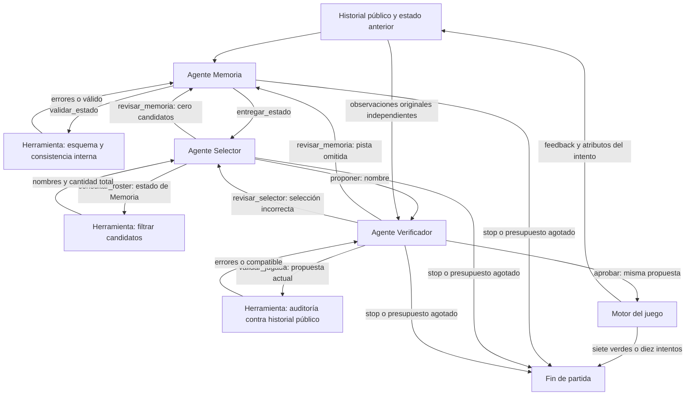

# Grafo operativo · Entregable 3

Los tres roles son llamadas separadas al mismo Ministral-3-3B-Instruct-2512,
con contextos y prompts propios. Los pesos comunes se eligen en validación.
El controlador interpreta una acción explícita del modelo cada vez; las
herramientas no deciden transferencias ni aprueban por su cuenta.

## Frontera de información

- Sólo `AgentSystem.play()` y el motor reciben el objetivo secreto. `decide()`
  recibe historial público y estado anterior. Ni prompts ni herramientas
  reciben el objetivo.
- `validar_estado` comprueba formato, vocabulario y contradicciones internas.
  No deduce restricciones faltantes del historial.
- `consultar_roster` usa **el estado escrito por Memoria**, aunque esté
  incompleto. Devuelve nombres y cantidad total: Selector decide qué nombre propone.
- `validar_jugada` reconstruye la evidencia pública original para auditar la
  propuesta, incluidos amarillos y repetición. No devuelve otro candidato.
- Verificador decide si aprueba o revisa. Si aprueba una mala propuesta,
  se juega y se contabiliza. No existe reemplazo ni aprobación automática.
- Una herramienta sí puede hacer gran parte de la deducción. El control
  algorítmico sin LLM mide explícitamente ese aporte.

## Acciones, ciclos y parada

| Actor | Acciones |
|---|---|
| Memoria | `validar_estado`, `entregar_estado`, `stop` |
| Selector | `consultar_roster`, `proponer`, `revisar_memoria`, `stop` |
| Verificador | `validar_jugada`, `aprobar`, `revisar_memoria`, `revisar_selector`, `stop` |

Memoria envía un JSON plano: `action`, `exact`, `forbidden`, `partial`, `year`,
`used`. El controlador separa `action` de los cinco campos del estado; no
rellena pistas. Los límites de año ausentes significan desconocido.
Memoria recibe cada valor unido a su color público, sin deducción previa.
Los valores exactos se escriben como listas (también los escalares).
Las acciones de auditoría y aprobación se ligan a la propuesta actual:
el verificador no puede cambiarla mediante argumentos.

Límites: 10 jugadas, 18 llamadas de modelo por turno, 160 por partida,
768 tokens de salida por llamada, temperatura 0. Error de API, `stop` o
presupuesto agotado termina la partida sin una jugada alternativa de código.
Los errores de protocolo solicitan otra respuesta y consumen presupuesto.
Cada llamada guarda mensajes, respuesta, acción, uso de tokens y latencia.

## Ablaciones

| Variante | Único cambio respecto del sistema completo |
|---|---|
| `no_examples` | Retira los ejemplos específicos de los tres prompts |
| `no_previous_state` | No reinyecta el estado del turno anterior a Memoria; conserva el historial completo |
| `no_revision` | Impide devolver trabajo a Memoria/Selector; puede auditar, aprobar o parar |

Las herramientas y los tres roles permanecen en todas las ablaciones.
Las técnicas se retiran por separado, no de forma acumulativa.

## Contexto después de herramientas

Selector y Verificador reciben el resultado vigente en un contexto fresco
con su mismo prompt, sin arrastrar consultas y candidatos anteriores. Esta
decisión de implementación evita confundir los atributos de un intento
anterior con la propuesta actual. El verificador recibe el historial público
antes de auditar; la herramienta siempre lo consulta completo e independiente
del estado de Memoria. Las entradas exactas están guardadas en cada `model_call`.
Memoria conserva su diálogo de corrección dentro del turno.
