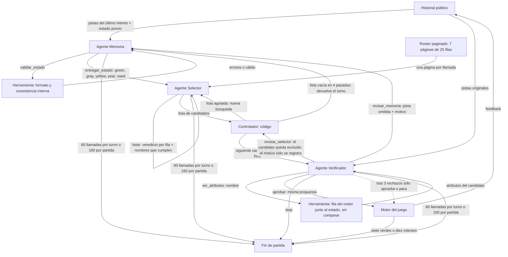

# Grafo operativo · Entregable 3 (protocolo v4)

Tres agentes, cada uno una llamada separada al mismo Ministral-3-3B-Instruct-2512
(4 bits, MLX) con **los mismos pesos** (un adaptador LoRA común), su propio prompt
versionado y su propio contexto. **Ninguna herramienta deduce**: el código (el
controlador) pagina el roster, muestra filas, calcula los años que permite el estado
de Memoria y toma el siguiente candidato de la lista, pero no filtra ni compara. Las herramientas
deterministas del D2 quedan sólo como controles de evaluación (`d2_tool`,
`algorithmic`).

## Agentes

| Agente | Recibe | Devuelve | Acciones | Para o transfiere cuando |
|---|---|---|---|---|
| Memoria | Pistas del último intento (campo, valor, color; año con la lectura literal de su flecha) y su estado previo. Ante una crítica: historial completo y motivo | Estado JSON `green`, `gray`, `yellow`, `year`, `used` | `validar_estado`, `entregar_estado` | Transfiere al Selector al entregar un estado válido. No tiene `stop`: su salida es entregar; su límite es el presupuesto |
| Selector | Estado de Memoria, nombres excluidos (jugados o rechazados), años que permite ese estado y una página de 25 filas del roster | Un veredicto por fila (`"Gwen ok"`, `"Ahri x regions"`) y los nombres que cumplen | `listar` (una por página) | Recorre las 7 páginas y entrega su lista al Verificador; si la lista sale vacía repite la búsqueda (3 pasadas muestreadas) y luego el controlador devuelve el turno a Memoria |
| Verificador | Candidato, pistas originales del historial y estado de Memoria | Aprobación o rechazo con motivo | `ver_atributos`, `aprobar`, `revisar_selector`, `revisar_memoria`, `stop` | Aprueba si nada contradice las pistas. Con `revisar_selector` el controlador excluye ese nombre y pasa el siguiente de la lista (o repite la búsqueda); el motivo se registra, pero no llega al Selector. Sólo `revisar_memoria` entrega el motivo, a Memoria. En prueba, las 18 devoluciones fueron `revisar_selector`. Tras 3 rechazos en el turno sólo puede aprobar o parar |

Por qué esta división: el diagnóstico del D1/D2 tiene tres partes y cada agente
toma una. Memoria **conserva lo revelado** (el `Sé:` del D2 guardaba sólo los
verdes). El Selector **busca en el roster**, el paso que el D2 documentó como el más
débil: cruzar condiciones contra 173 filas de una pasada. Aquí lo hace de a 25
filas y con un veredicto explícito por fila. El Verificador es **un control antes de
gastar un intento**: revisa una sola fila contra todas las pistas originales; recibe
el historial de pistas además del estado, y `ver_atributos` coloca la fila del
candidato junto al estado de Memoria.

## Frontera de información

- Sólo `AgentSystem.play()` y el motor reciben el objetivo secreto. Ni prompts ni
  herramientas lo reciben.
- `validar_estado` comprueba formato, vocabulario y contradicciones internas del
  estado. No deduce restricciones faltantes del historial.
- La paginación entrega filas del roster en su orden, sin filtrar ni marcar nada.
  `years_allowed` lista los años que permite **el estado escrito por Memoria**
  (`eq`/`gt`/`lt`): reformatea el estado del agente, no consulta la evidencia.
- `ver_atributos` devuelve la fila del candidato junto a cada entrada del estado
  del mismo campo. No compara ni marca coincidencias.
- Si el Verificador aprueba una mala propuesta, se juega y se contabiliza. No hay
  reemplazo ni aprobación automática.

## Formato, tolerancias y reintentos

- Memoria, Selector y Verificador responden JSON. La respuesta se **prellena**
  (`{"action":"`, `{"action":"listar","revision":`) para que el adaptador no vuelva
  a otro formato, y se ignora texto posterior al primer objeto.
- El controlador normaliza sólo formatos inequívocos y lo registra (`normalized`):
  listas vacías, cláusulas de listas de un valor, notación `A+B` del D2, prefijo
  `Sé:`, año escrito como texto y `green.release_year = X` como `year.eq = X`.
- **Reintentos muestreados con semilla fija.** A temperatura 0 una entrada idéntica
  repite la misma salida. Un error de formato de Memoria se reintenta con su
  entrada original, los errores, temperatura 0,6 y semilla `1000·turno + reintento`.
  Una búsqueda vacía se repite con temperatura 0,7 y semilla por turno, pasada y
  página. La corrida sigue siendo reproducible; cada llamada guarda temperatura y
  semilla. El reintento no garantiza salir: en Samira, Memoria repitió 60 veces el
  mismo error de formato en el tercer turno.
- Si el Selector no lista nada en cuatro pasadas, el controlador (no un agente)
  devuelve el turno a Memoria con un motivo fijo: «El Selector no encontró en el
  roster ningún campeón que cumpla el estado». Refleja la lista vacía del modelo, no
  una comprobación: en los cuatro paros del Selector el secreto sí cumplía el estado.
- Límites: 10 jugadas, 60 llamadas por turno, 160 por partida, 3 rechazos por turno,
  768 tokens por llamada (400 el Selector).

## Pesos comunes

Un solo adaptador LoRA para los tres roles, entrenado con la entrada exacta de
cada agente y etiquetas calculadas por el motor a partir de la evidencia pública,
como en el D2. En la partida cada agente decide solo. Partición del D2: 128
objetivos de entrenamiento; los 15 de validación sólo miden la pérdida y eligen
pesos; los 30 de prueba no aparecen. Cadena de entrenamiento (cada ronda parte de
la anterior):

| Ronda | Config | Datos | Qué aprende |
|---|---|---|---|
| D2 | `lora_config_round2.yaml` | `make_data.py` | Selector en formato `Sé/Compatibles` |
| 1 | `lora_config_d3.yaml` | `make_data_d3.py` | Memoria, Verificador y Selector D2 (v3) |
| 2 | `lora_config_d3_paginas.yaml` | `--paginas` | Selector por páginas, sólo lista (respondía `[]`; descartada como final) |
| 3 | `lora_config_d3_paginas_cot.yaml` | `--paginas --out d3_paginas_cot` | Veredicto por fila |
| 4 | `lora_config_d3_paginas_cot2.yaml` | `--paginas --out d3_paginas_cot2` | Años permitidos |
| 5 | `lora_config_d3_paginas_cot3.yaml` | `--paginas --repaso 300 --semilla 10 --out d3_paginas_cot3` | Más búsqueda y repaso de Memoria (**seleccionado**) |

Selector por páginas medido contra el motor en objetivos de validación:
ronda 2, casi nunca lista (exhaustividad 2%); ronda 3, precisión 37% y exhaustividad 23%; ronda 4, 83% y
42% (el error dominante era el año); ronda 5, 65% y 98%, y el primer nombre listado
cumple en 8 de 9 turnos.

## Técnicas de prompting por agente

| Técnica | Agente | Fallo del D1/D2 que ataca | Medición en prueba |
|---|---|---|---|
| Descomposición en roles (memoria / búsqueda / control) | Los tres | Un solo prompt mezclaba recordar, buscar y jugar | Sin ablación propia: 25/30 frente a 14/30 del D2 mide toda la configuración (adaptador nuevo, hasta 768 tokens y más de 6 veces las llamadas), no sólo la división en roles |
| Revisión con devolución del candidato | Verificador → controlador (siguiente candidato) / Memoria | Jugadas que contradicen lo revelado | Sin devolución: 14/30 (−11, p = 0,003). Mide a la vez revisar y poder continuar: 13 de los 16 paros son la petición de revisión, que en esta ablación detiene la partida |
| Ejemplos resueltos (few-shot) | Los tres | Mala lectura de verde/gris/amarillo y de las filas | Sin ejemplos: 18/30 (−7, p = 0,12; 39,0% de incompatibles). El adaptador se entrenó con ejemplos en el prompt, así que retirarlos también lo saca de distribución; no identifica qué agente se beneficia |
| Memoria explícita incremental (estado previo reinyectado) | Memoria | Olvidar restricciones de intentos anteriores | Sin resumen previo: 29/30 (+4, p = 0,22; 21,3% de incompatibles frente a 15,4%). No es significativo: cuestiona la ventaja del resumen incremental, pero no prueba que reconstruir desde el historial sea mejor |
| Búsqueda paginada con veredicto por fila (razonamiento estructurado) | Selector | Cruzar condiciones contra 173 filas de una pasada | Sin ablación propia; en validación, la exhaustividad pasó de 23% a 98% entre rondas de entrenamiento |
| Salida estructurada con prefill | Los tres | Respuestas fuera de formato | Sin ablación propia; errores de protocolo registrados |
| Uso de herramienta decidido por el agente | Verificador | Juzgar atributos que no conoce | Sin ablación propia; el Verificador consultó `ver_atributos` en las 113 revisiones de prueba. Memoria nunca usó `validar_estado` |

## Resultados en prueba (30 objetivos, mismo criterio)

| Variante | Resueltas | Violación estricta | Paros | p frente al sistema |
|---|---:|---:|---:|---:|
| Referencia directa, sin ajuste LoRA (prompt del D1) | 2 | 99,1% | 0 | < 10⁻⁵ |
| Solución D2 (LoRA, sin agentes) | 14 | 81,1% | 0 | 0,007 |
| **Sistema de tres agentes (v4)** | **25** | **15,4%** | 5 | — |
| sin ejemplos en los prompts | 18 | 39,0% | 12 | 0,12 |
| sin resumen previo de Memoria | 29 | 21,3% | 1 | 0,22 |
| sin devolución para corregir | 14 | 26,7% | 16 | 0,003 |
| D2 con consulta (el código filtra el roster) | 30 | 60,6% | 0 | |
| Sin modelo (el código filtra con toda la evidencia) | 30 | 0,0% | 0 | |

Paros: partidas detenidas por protocolo o presupuesto. Sin devolución, 13 paros son
la petición de revisión del Verificador (la ablación detiene la partida) y 3 son
por presupuesto.

Comparaciones pareadas (McNemar exacto, exploratorio): el sistema gana 13 y pierde
2 frente al D2 (p = 0,007), y 24 a 1 frente a la referencia directa. Sin devolución
pierde 12 y gana 1 (p = 0,003). Resuelve en 3,24 intentos de media.

Los 5 paros terminan por agotar 60 llamadas en un turno. En 4 (Morgana, Thresh,
Ashe, Soraka) Memoria entrega un estado equivalente al público, pero el Selector
descarta al secreto en todas las pasadas: a Morgana y a Ashe las marca
incompatibles por posición ante un amarillo de un solo valor, un caso que su
ejemplo no cubre. En Samira, Memoria encadena 60 respuestas fuera de protocolo en
el tercer turno.

## Historia del protocolo

- **v1** (`results/d3/v1/`): herramientas que filtraban el roster y auditaban
  contra toda la evidencia; bucles de los agentes. 4/15 en validación.
- **v2** (`results/d3/v2_herramientas/`): mismas herramientas, bucles corregidos;
  10/15. Descartado por decisión del equipo: esas herramientas hacen la deducción
  que el entregable pide al modelo (son la variante que el D2 trató como control).
- **v3** (`results/d3/v3/`): sin herramientas que deduzcan; Selector en el formato
  del D2 y adaptador multirol. 5/15 en validación y 9/30 en prueba: el Selector
  acertaba 37% de sus jugadas y repetía la rechazada (bucle greedy).
- **v4** (este documento): Selector por páginas con veredicto por fila, años
  permitidos, límite de rechazos y reintentos muestreados. Validación: D2 8/15,
  v4 6/15 (ronda 4), 9/15 (ronda 5) y 11/15 (ronda 5 con búsqueda repetida,
  seleccionado). Prueba: 25/30.

Todos los ajustes se hicieron con objetivos de entrenamiento y validación. Los 30
objetivos de prueba ya se habían observado antes de diseñar v4 (D1/D2, v1 parcial y
v3 completa con sus ablaciones). Ninguno entró en los datos de entrenamiento y los
pesos y límites de v4 se eligieron con validación, pero no puede descartarse que ese
conocimiento previo influyera. El resultado de la ablación sin resumen previo
(29/30) aparece en prueba y no se usó para cambiar el sistema.
